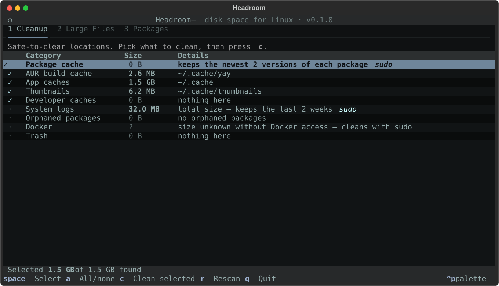

# Headroom for Linux

**A disk-space utility for Arch and Omarchy.** Clear caches, hunt down large files, and uninstall packages cleanly — in a fast, keyboard-driven terminal app that picks up your Omarchy theme.

The Linux sibling of [Headroom for macOS](https://github.com/kanibusrex/headroom).



## Features

### 🧹 Cleanup
Scan first, see how much each category holds, pick what to clean, and confirm before anything is removed.

| Category | What it clears |
|---|---|
| Package cache | Old package downloads in `/var/cache/pacman/pkg` (keeps the 2 newest versions so you can roll back) |
| AUR build cache | Sources and builds left in `~/.cache/yay` and `~/.cache/paru` |
| App caches | Everything else in `~/.cache` |
| Thumbnails | File-manager image previews |
| Developer caches | npm, Cargo, Gradle and Bun download caches |
| System logs | systemd journal older than 2 weeks |
| Orphaned packages | Dependencies nothing needs anymore (`pacman -Qdt`) |
| Docker | Stopped containers, unused images and build cache — never volumes |
| Trash | Empties `~/.local/share/Trash` |

### 📄 Large Files
Finds the biggest files in your home folder (100 MB+, 500 MB+ or 1 GB+) with size and last-modified date. Open the containing folder before deciding; removal goes to the Trash.

### 🗑 Packages
Lists your explicitly installed packages by size (repo or AUR), with a filter. Uninstalling runs `sudo pacman -Rns`, and Headroom also finds the leftovers the app scattered across `~/.config`, `~/.local/share`, `~/.cache`, `~/.local/state` and `~/.<name>` — you choose whether to trash those too.

## Safety

- **Scan before clean** — nothing is removed without an explicit confirmation.
- Cleanup only deletes the *contents* of well-known regenerable locations, never your documents or app data.
- Anything system-level (pacman, journal, Docker) runs in your terminal, where you see the exact command and pacman asks before removing packages.
- Large Files and package leftovers go to the **Trash**, not permanent deletion. `.git` folders are never offered.
- Core packages (`base`, `linux`, `systemd`, `pacman`, `hyprland`, `omarchy*`, …) can't be uninstalled from Headroom.
- Files that are locked or in use are skipped, never forced.

## Install

Needs Python 3.11+. `pacman-contrib` (for `paccache`) enables package-cache cleanup.

```sh
git clone https://github.com/kanibusrex/headroom-linux
cd headroom-linux
./install.sh
headroom
```

`headroom --summary` prints what can be cleaned without opening the app.

## Keys

| Key | Action |
|---|---|
| `1` `2` `3` | Switch tabs |
| `space` / `a` | Select a cleanup category / all or none |
| `c` | Clean selected |
| `t` / `o` / `m` | Trash file / open its folder / change minimum size |
| `u` or `Enter` · `/` | Uninstall package · filter |
| `r` · `q` | Rescan · quit |

## Development

```sh
python3 -m venv .venv && .venv/bin/pip install -e '.[dev]'
.venv/bin/pytest
.venv/bin/headroom
```
